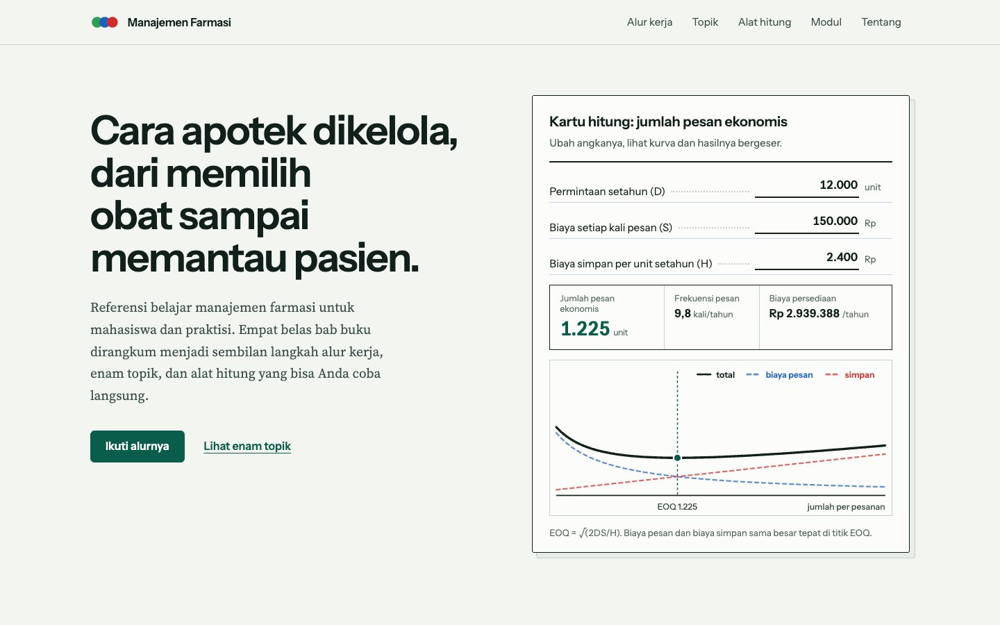
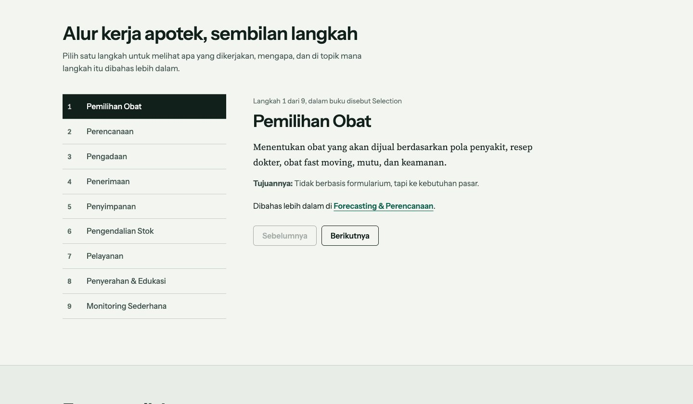
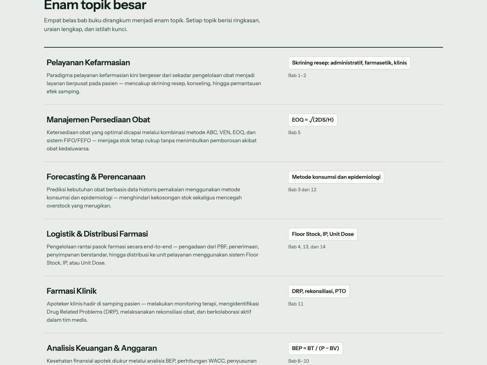
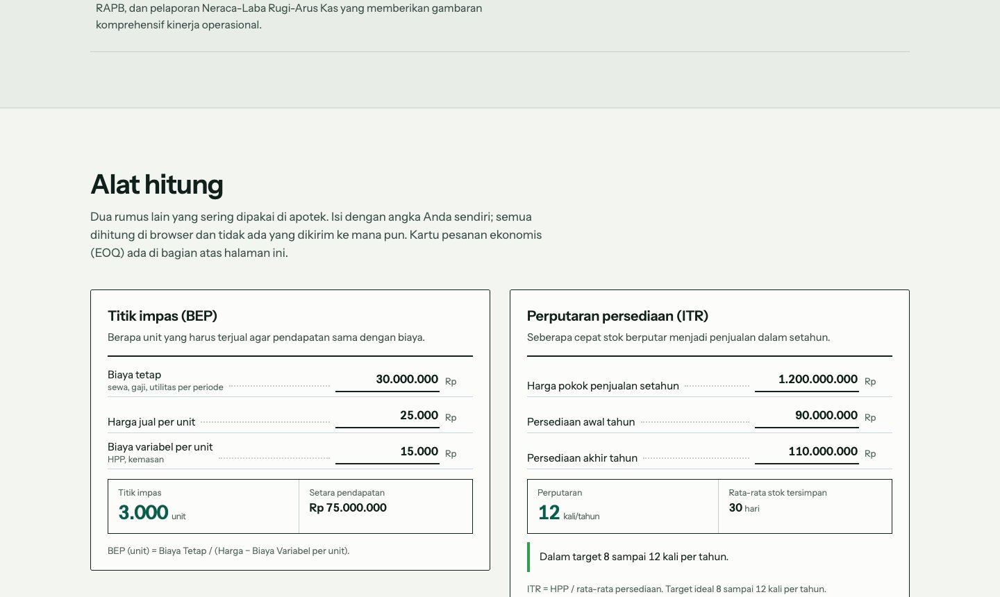
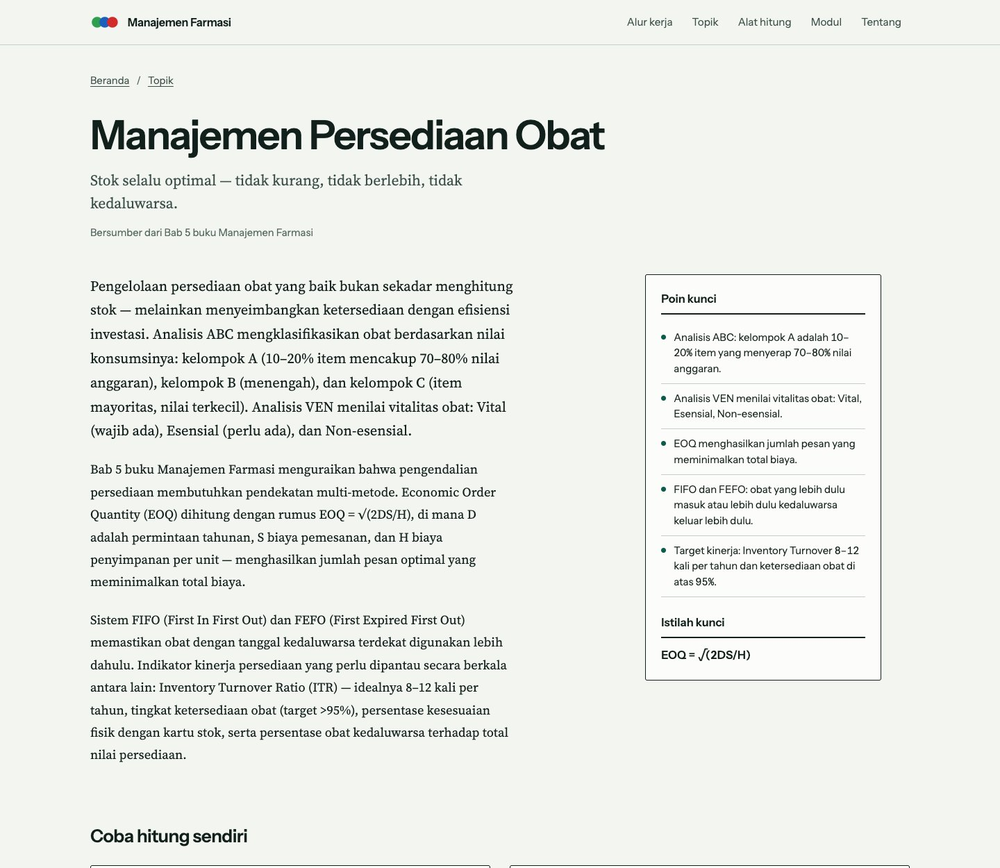
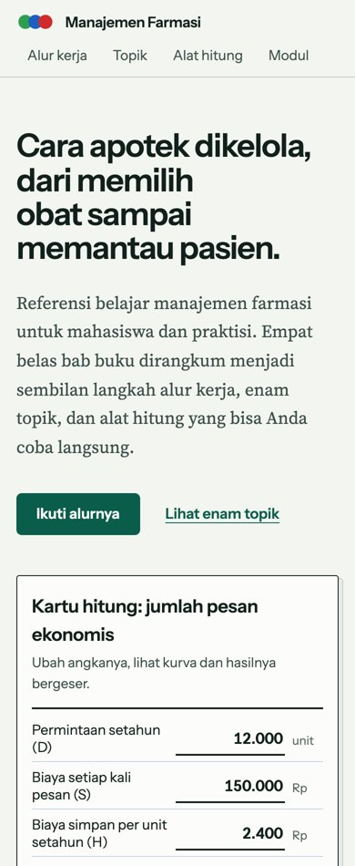

<div align="right">

[English](README.md) · **Bahasa Indonesia**

</div>

# Manajemen Farmasi: referensi belajar manajemen farmasi



[](https://react.dev)
[](https://www.typescriptlang.org)
[](https://vite.dev)
[](LICENSE)

Situs berbahasa Indonesia yang mengubah buku *Manajemen Farmasi* (Prasetyawan dkk., 2024) menjadi bahan yang bisa dijelajahi: sembilan langkah alur kerja apotek, enam topik dengan uraian lengkap, dan alat hitung untuk rumus yang paling sering dijumpai mahasiswa. Dibuat untuk mahasiswa dan praktisi farmasi. Situs: [manajemen-farmacy.vercel.app](https://manajemen-farmacy.vercel.app).

## Isinya

- **Sembilan langkah alur kerja:** dari pemilihan obat sampai pemantauan pasien. Pilih satu langkah untuk melihat apa yang dikerjakan, mengapa, dan topik mana yang membahasnya lebih dalam.
- **Enam topik:** pelayanan kefarmasian, persediaan, forecasting, logistik, farmasi klinik, dan keuangan. Masing-masing berisi ringkasan, poin kunci, uraian lengkap, serta istilah atau rumus kunci.
- **Alat hitung:** pesanan ekonomis (EOQ, dengan kurva biaya langsung), titik impas (BEP), dan perputaran persediaan (ITR). Semua dihitung di browser, tidak ada data yang dikirim ke mana pun.
- **Delapan modul pengayaan** di samping enam topik.

Identitas visualnya meminjam dari apotek itu sendiri: tiga lingkaran logo golongan obat di kemasan (hijau, biru, merah), dan "kartu stok" bergaya buku besar untuk alat hitung.

## Tangkapan layar

| Beranda | Alur kerja |
|---|---|
|  |  |

| Topik | Alat hitung |
|---|---|
|  |  |

| Halaman topik | Mobile |
|---|---|
|  |  |

## Teknologi

| Bagian | Teknologi |
|---|---|
| Aplikasi | React 18, TypeScript, React Router |
| Build | Vite |
| Gaya | CSS biasa dengan design token (tanpa framework UI) |
| Tipografi | Instrument Sans dan Source Serif 4 |
| Pengujian | Vitest (rumus) |

Dependensi runtime hanya tiga: `react`, `react-dom`, dan `react-router-dom`.

## Memulai

```bash
git clone https://github.com/Rizky28eka/Slicing-PharmaGuide.git
cd Slicing-PharmaGuide
npm install
npm run dev
```

Skrip lain: `npm run build` · `npm run typecheck` · `npm run lint` · `npm test`

[`vercel.json`](vercel.json) mengarahkan alamat yang tidak dikenal ke `index.html`, sehingga tautan langsung seperti `/layanan/farmasi-klinik` tetap berfungsi setelah di-refresh.

## Struktur proyek

```text
src/
├── components/   Header dan footer, alat hitung, penjelajah alur kerja
├── data/         Topik, langkah alur kerja, modul pengayaan
├── lib/          Rumus (dengan tes), format angka
├── pages/        Beranda, halaman topik, halaman tidak ditemukan
└── index.css     Design token dan gaya
```

## Konten dan kredit

Teks di situs ini merangkum buku *Manajemen Farmasi*; hak cipta buku ada pada para penulis dan penerbit:

Prasetyawan, F., Serdiani, FISQua, Arief, I., Anggraini, R., Sarifudin, B. A., Suhery, D., Pratama, M. W., Yuniar, C. R., Ihsan, M., Madiati, N., Mayasari, S., Hasanah, R., Andika, M., & Syavardie, Y. (2024). *Manajemen Farmasi*. PT Pena Muda Media.

Kode situs dirilis di bawah [Lisensi MIT](LICENSE).

## Penulis

**Rizky Eka Haryadi**  
[GitHub](https://github.com/Rizky28eka) · [LinkedIn](https://www.linkedin.com/in/rizky28eka/) · [Portofolio](https://heyeka.vercel.app)
