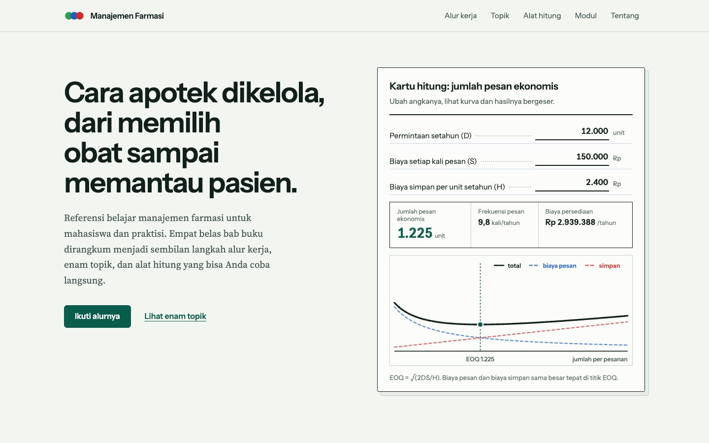
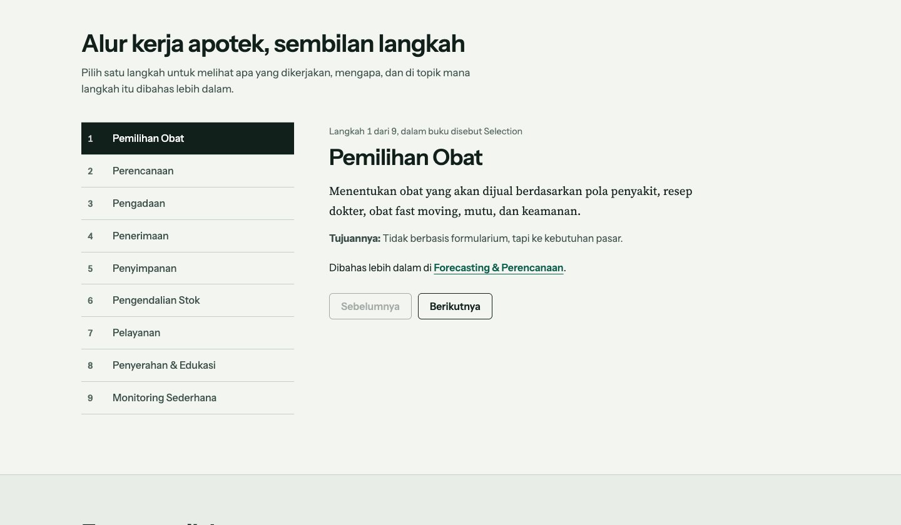
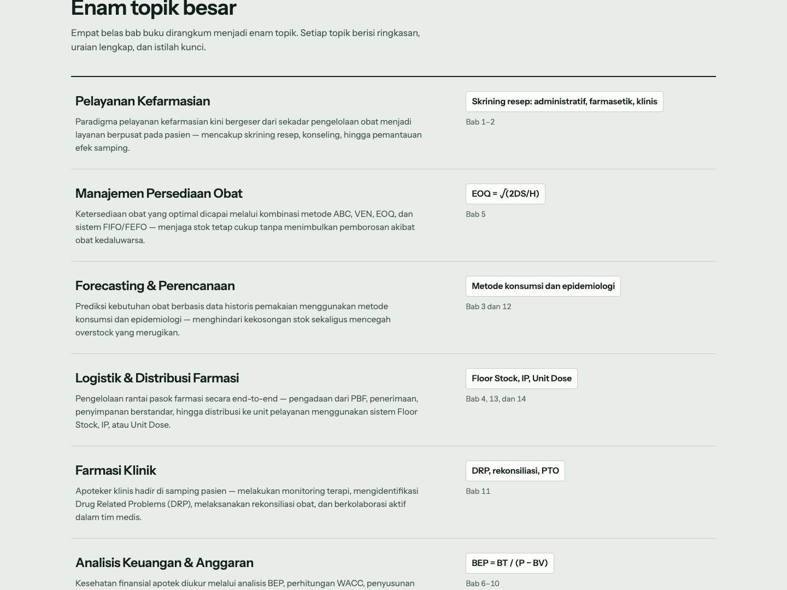
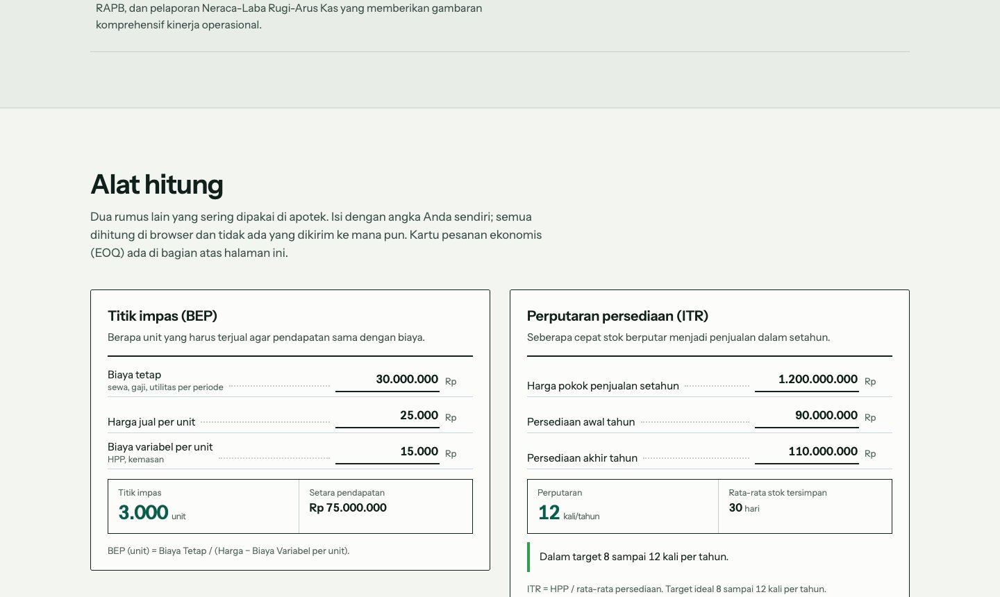
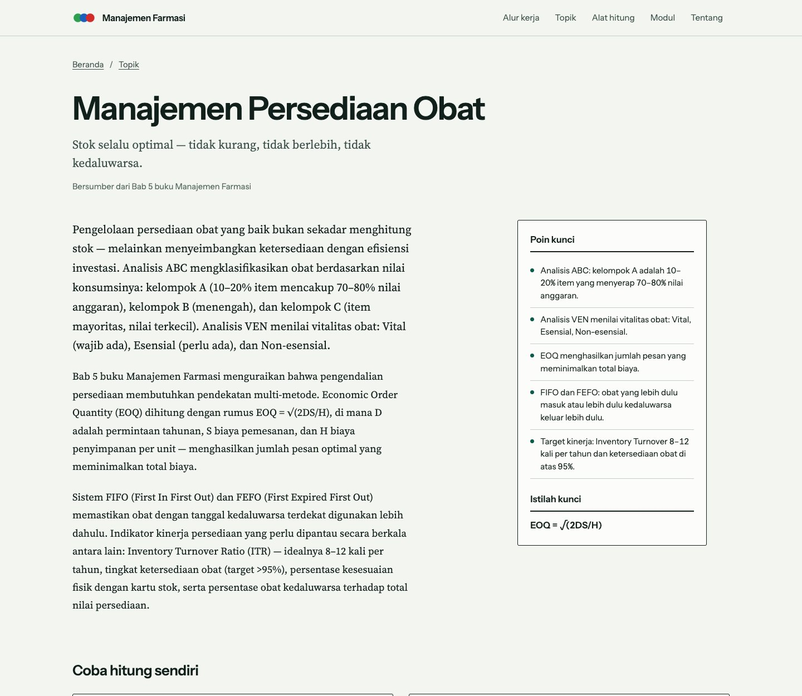
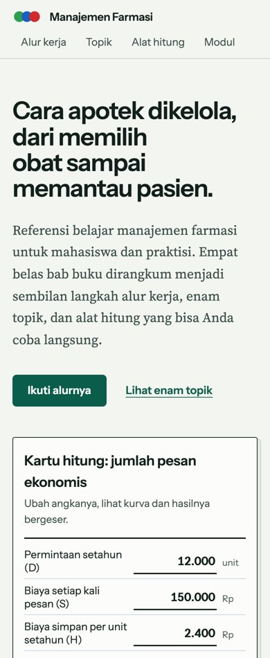

<div align="right">

**English** · [Bahasa Indonesia](README.id.md)

</div>

# Manajemen Farmasi: a study reference for pharmacy management



[](https://react.dev)
[](https://www.typescriptlang.org)
[](https://vite.dev)
[](LICENSE)

An Indonesian-language website that turns the textbook *Manajemen Farmasi* (Prasetyawan et al., 2024) into something you can explore: the nine-step workflow of a pharmacy, six topics with full write-ups, and calculators for the formulas students meet most often. It is built for pharmacy students and practitioners. Live site: [manajemen-farmacy.vercel.app](https://manajemen-farmacy.vercel.app).

## What is in it

- **Nine-step workflow:** from drug selection to monitoring the patient. Pick a step to see what is done, why, and which topic covers it in depth.
- **Six topics:** pharmacy services, inventory, forecasting, logistics, clinical pharmacy, and finance. Each has a summary, key points, the full write-up, and the key term or formula.
- **Calculators:** economic order quantity (EOQ, with a live cost curve), break-even point (BEP), and inventory turnover (ITR). Everything is computed in the browser; nothing is sent anywhere.
- **Eight enrichment modules** listed alongside the six topics.

The visual identity borrows from the pharmacy itself: the three circles of the drug-classification logo on packaging (green, blue, red), and a ledger-style "stock card" for the calculators.

## Screenshots

| Home | Workflow |
|---|---|
|  |  |

| Topics | Calculators |
|---|---|
|  |  |

| A topic page | Mobile |
|---|---|
|  |  |

## Tech stack

| Area | Technology |
|---|---|
| App | React 18, TypeScript, React Router |
| Build | Vite |
| Styling | Plain CSS with design tokens (no UI framework) |
| Typography | Instrument Sans and Source Serif 4 |
| Tests | Vitest (formulas) |

The runtime has three dependencies: `react`, `react-dom`, and `react-router-dom`.

## Getting started

```bash
git clone https://github.com/Rizky28eka/Slicing-PharmaGuide.git
cd Slicing-PharmaGuide
npm install
npm run dev
```

Other scripts: `npm run build` · `npm run typecheck` · `npm run lint` · `npm test`

[`vercel.json`](vercel.json) rewrites unknown paths to `index.html`, so direct links such as `/layanan/farmasi-klinik` keep working after a refresh.

## Project structure

```text
src/
├── components/   Header and footer, calculators, workflow explorer
├── data/         Topics, workflow steps, enrichment modules
├── lib/          Formulas (with tests), number formatting
├── pages/        Home, topic page, not found
└── index.css     Design tokens and styles
```

## Content and credits

The texts summarise the book *Manajemen Farmasi*; its copyright belongs to the authors and publisher:

Prasetyawan, F., Serdiani, FISQua, Arief, I., Anggraini, R., Sarifudin, B. A., Suhery, D., Pratama, M. W., Yuniar, C. R., Ihsan, M., Madiati, N., Mayasari, S., Hasanah, R., Andika, M., & Syavardie, Y. (2024). *Manajemen Farmasi*. PT Pena Muda Media.

The website code is released under the [MIT License](LICENSE).

## Author

**Rizky Eka Haryadi**  
[GitHub](https://github.com/Rizky28eka) · [LinkedIn](https://www.linkedin.com/in/rizky28eka/) · [Portfolio](https://heyeka.vercel.app)
