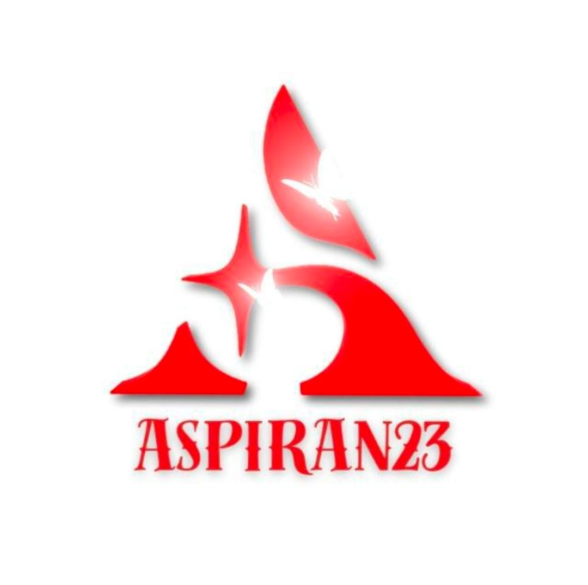

# 💊 Manajemen Farmasi - Digital Reference

Sebuah platform referensi digital komprehensif yang memadukan aspek manajerial dan klinis farmasi. Dirancang khusus untuk membantu mahasiswa dan praktisi farmasi memahami alur kerja apotek secara mendalam, mulai dari perencanaan hingga monitoring pasien.

---

## 📌 1. Project Title & Description

* **Nama Project**: Manajemen Farmasi Landing Page
* **Deskripsi**: Website edukasi yang menyajikan referensi komprehensif mengenai tata kelola farmasi, menggabungkan teori manajerial dengan praktik klinis di lingkungan apotek.
* **Tujuan**: Menyediakan sumber belajar yang interaktif dan mudah dipahami bagi calon apoteker dan tenaga teknis kefarmasian mengenai sistem manajemen apotek modern.

---

## 📌 2. Overview / Background

* **Latar Belakang**: Pengelolaan apotek melibatkan banyak aspek yang kompleks, mulai dari regulasi, logistik, hingga pelayanan klinis. Seringkali, materi ini sulit dipahami tanpa visualisasi alur yang sistematis.
* **Kenapa Project Ini Dibuat**: Untuk menjembatani kesenjangan antara teori akademik dan implementasi praktis di lapangan dengan cara yang lebih visual dan modern.
* **Solusi**: Menghadirkan dashboard informasi yang ringkas, modul pengayaan yang terstruktur, dan visualisasi "9 Langkah Alur Manajemen Farmasi" yang interaktif.

---

## 📌 3. Features (Fitur Utama)

* **Dashboard Statistik**: Ringkasan data (14 Bab Materi, 8 Modul Praktik, 2024 Tahun Terbit).
* **Alur Manajemen Interaktif**: Visualisasi 9 langkah proses inti di apotek (Selection -> Planning -> ... -> Monitoring).
* **Materi Tambahan Komprehensif**: 8 modul pengayaan (Evaluasi Resep, Analisis Finansial, Regulasi, dll).
* **Responsive UI**: Desain premium yang optimal di semua ukuran layar (Mobile, Tablet, Desktop).
* **Smooth Navigation**: Navigasi berbasis anchor untuk perpindahan antar section yang mulus.

---

## 📌 4. Tech Stack

* **Frontend**: [React 18](https://reactjs.org/) + [TypeScript](https://www.typescriptlang.org/)
* **Styling**: [Tailwind CSS](https://tailwindcss.com/)
* **UI Components**: [Shadcn UI](https://ui.shadcn.com/) (Radix UI)
* **Icons**: [Lucide React](https://lucide.dev/)
* **Build Tool**: [Vite](https://vitejs.dev/)
* **Package Manager**: [Bun](https://bun.sh/) / [NPM](https://www.npmjs.com/)

---

## 📌 5. System Architecture

* **Arsitektur**: Single Page Application (SPA).
* **Struktur**: Component-based Architecture dengan pemisahan antara `UI Components` (reusable) dan `Site Components` (section-specific).
* **Styling Pattern**: Utility-first CSS menggunakan Tailwind dengan integrasi CSS Variables untuk tema warna.

---

## 📌 6. Installation Guide

### Requirements
* Node.js v18.x atau lebih baru
* Bun (direkomendasikan) atau NPM

### Step-by-step
1. **Clone Repository**
   ```bash
   git clone https://github.com/Rizky28eka/ui-slicing-guru.git
   ```
2. **Install Dependencies**
   ```bash
   bun install
   # atau
   npm install
   ```
3. **Setup Environment**
   *(Opsional: Jika ada file .env.example, salin ke .env)*
   ```bash
   cp .env.example .env
   ```
4. **Run Project**
   ```bash
   bun dev
   # atau
   npm run dev
   ```

---

## 📌 7. Usage

* **Eksplorasi Materi**: User dapat melihat statistik utama di section Hero.
* **Mempelajari Alur**: Scroll ke section "Alur Manajemen" untuk melihat urutan kerja profesional di apotek.
* **Materi Pengayaan**: Klik pada kartu materi di section "Materi Tambahan" untuk melihat detail topik.

---

## 📌 8. API Documentation

* *Saat ini project ini adalah frontend-only (static landing page). Integrasi API direncanakan pada roadmap masa depan.*

---

## 📌 9. Screenshots / Demo


*(Ganti dengan path screenshot terbaru jika tersedia)*

---

## 📌 10. Folder Structure

```text
├── public/                # Static assets (images, icons)
├── src/
│   ├── components/
│   │   ├── site/          # Section-specific components (Hero, About, etc.)
│   │   └── ui/            # Reusable shadcn/ui components
│   ├── pages/             # Main page layouts
│   ├── hooks/             # Custom React hooks
│   ├── lib/               # Utilities (utils.ts)
│   └── index.css          # Global styles & tailwind directives
├── tailwind.config.ts     # Tailwind configuration
└── vite.config.ts         # Vite configuration
```

---

## 📌 11. Roadmap / Future Development

* [ ] **Detail Materi**: Menambahkan halaman detail untuk ke-14 bab materi.
* [ ] **Interactive Quiz**: Fitur evaluasi mandiri untuk setiap modul praktik.
* [ ] **Dark Mode**: Dukungan tema gelap untuk kenyamanan membaca di malam hari.
* [ ] **Backend Integration**: Integrasi dengan CMS untuk manajemen konten dinamis.

---

## 📌 12. Contributing

1. Fork Project ini.
2. Buat Feature Branch (`git checkout -b feature/AmazingFeature`).
3. Commit perubahan Anda (`git commit -m 'Add some AmazingFeature'`).
4. Push ke Branch (`git push origin feature/AmazingFeature`).
5. Buka Pull Request.

---

## 📌 13. License

Distributed under the **MIT License**. Lihat `LICENSE` untuk informasi lebih lanjut.

---

## 📌 14. Author / Credits

* **Rizky Eka** - *Lead Developer* - [@Rizky28eka](https://github.com/Rizky28eka)
* **Bilcode Team** - *Contributor*

---

🚀 *Project ini dibangun dengan semangat untuk memajukan edukasi farmasi di Indonesia.*
